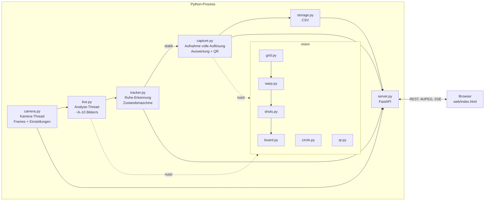
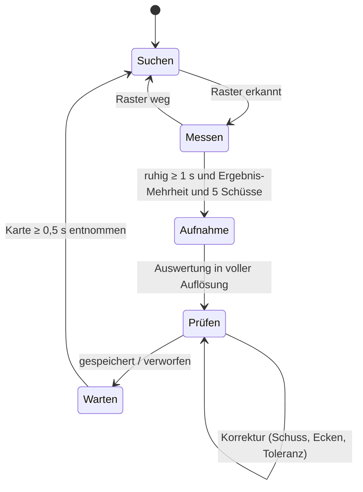

# Architektur – Nikolo-Scheibe auswerten (Python + Web-Bedienung)

Spec: [`spec/nikolo-auswertung-live2.html`](../spec/nikolo-auswertung-live2.html) – funktionierender Browser-Prototyp.
Ziel: Ein Windows-Rechner mit USB-Webcam erkennt aufgelegte Karten **automatisch**, zählt die Punkte und schreibt die Ergebnisse in eine **CSV-Datei**. Bedienung im Browser, Auslieferung als **.exe**.

## Rahmen

| | Entscheidung | Grund |
|---|---|---|
| Plattform | Windows 10/11, ein Rechner, USB-Webcam | Einsatz am Schießstand |
| Backend | Python 3.12, OpenCV, FastAPI + Uvicorn | OpenCV steuert die Kamera direkt und rechnet schnell; FastAPI liefert UI und API |
| Bedienung | Web-UI (HTML + Vanilla-JS) auf `http://127.0.0.1:8765` | Bekannte Oberfläche aus der Spec, kein Framework, kein Build-Schritt |
| Speicher | CSV-Datei (`;`, UTF-8 mit BOM, Excel-tauglich) | Wunsch; direkt in Excel öffnen |
| Auslieferung | PyInstaller `onedir` + Startmenü-/Desktop-Verknüpfung, gebaut über GitHub Actions | Kein Python nötig am Zielrechner; `onedir` startet schneller und löst seltener Virenscanner-Fehlalarme aus als `onefile` |
| Netzwerk | Nur `127.0.0.1`, kein Internet nötig | Offline am Schießstand, keine Freigaben in der Firewall |

## Komponenten



### Paketstruktur

```
labinett/
  nikolo/
    __main__.py      Start: Server hochfahren, Browser öffnen
    config.py        Einstellungen (config.toml neben der exe): Kamera, Drehung, Pfade, Schwellen
    camera.py        cv2.VideoCapture (CAP_DSHOW), Auflösung, Fokus/Belichtung/Weißabgleich sperren
    live.py          Analyse-Schleife: Frame verkleinern → vision → tracker → Overlay
    tracker.py       Ruhe-Erkennung und Zustände (siehe unten)
    capture.py       aktuelle Aufnahme: Bilder, Ecken, Schüsse, Korrekturen, Neuberechnung
    storage.py       CSV lesen/anhängen/löschen, Sperre durch Excel erkennen
    server.py        FastAPI-Routen, MJPEG-Stream, Server-Sent Events
    vision/
      board.py       Feldbelegung, Bewertung, Sicherheit (1:1 aus der Spec)
      grid.py        Papier → Raster-Raute → 4 Ecken (Linien-Fit), Plausibilitätsprüfung
      warp.py        Homographie, begradigtes 720×720-Bild
      shots.py       Löcher finden, überlagerte Löcher per k-means trennen
      circle.py      Kreis mit Schützennummer finden (Ausschnitt fürs Ablesen)
      qr.py          UUID aus dem QR-Code (cv2.QRCodeDetector, offline)
  web/
    index.html, app.js, style.css
  tests/
    synth.py         synthetische Scheiben (verdreht, verrauscht)
    fixtures/        echte Fotos + erwartete Ergebnisse (*.json)
    test_*.py        pytest
  packaging/
    nikolo.spec      PyInstaller
  .github/workflows/
    build-windows.yml  Tests + exe bauen, bei Tag als Release-Datei
  spec/              HTML-Prototyp (Referenz)
  docs/
```

Regel: `vision/` ist reine Logik (NumPy-Arrays rein, Ergebnisse raus), ohne Kamera, Threads oder HTTP. Damit lässt sie sich mit Fotos testen.

## Übernahme der Erkennung aus der Spec

Der Algorithmus bleibt gleich. OpenCV ersetzt die handgeschriebenen Bausteine:

| Spec (JS) | Python |
|---|---|
| `otsu`, Schwellwerte | `cv2.threshold(..., THRESH_OTSU)` + gleiche Klemmen (60–150 bzw. 60–130) |
| `label` | `cv2.connectedComponentsWithStats` |
| `opening` | `cv2.morphologyEx(MORPH_OPEN)` mit quadratischem Kern |
| Löcher füllen (Rand-Komponenten) | `cv2.floodFill` vom Rand bzw. Konturen mit `RETR_EXTERNAL` |
| `homography`, `normalize` | `cv2.getPerspectiveTransform` + `cv2.warpPerspective` |
| `fitSide` | gleiche Logik in NumPy (äußerste Punkte je Abschnitt, `cv2.fitLine`) |
| k-means für Doppellöcher | `cv2.kmeans` |
| jsQR | `cv2.QRCodeDetector` |
| `score` | 1:1 portiert |

Die magischen Zahlen (`.045*S`, `.058`, `.09`, Klemmen …) wandern dokumentiert in `config.py` (`DetectionConfig`).

## Live-Modus ohne Springen

Ursachen fürs Springen im Prototyp: Die Webcam stellt Fokus und Belichtung laufend nach, jedes Bild wird unabhängig ausgewertet, und die Anzeige wechselt bei „Raster weg“ Größe und Inhalt.

1. **Kamera fixieren:** Autofokus, Belichtung und Weißabgleich nach dem Einrichten sperren (`CAP_PROP_AUTOFOCUS`, `CAP_PROP_FOCUS`, `CAP_PROP_AUTO_EXPOSURE`, `CAP_PROP_EXPOSURE`). In der UI: „Kamera einrichten“ mit Reglern; Werte landen in `config.toml`. Fallback: Treiber-Dialog über `CAP_PROP_SETTINGS`.
2. **Anzeige ruhig:** Das Livebild hat immer dieselbe Größe. Raster und Löcher werden als Overlay eingezeichnet, die Ecken geglättet (gleitender Mittelwert, bei großen Sprüngen zurückgesetzt).
3. **Auswertung erst nach Ruhe:** siehe Tracker.

## Tracker und automatische Aufnahme



- **Ruhig:** Über die letzten ~8 Analysebilder bewegt sich keine Ecke mehr als ~1 % der Rasterdiagonale.
- **Ergebnis-Mehrheit:** Mindestens 75 % dieser Bilder liefern dieselbe Signatur (Anzahl Schüsse + sortierte Werte). Kippt ein Schuss an der Linie hin und her, wird trotzdem aufgenommen; der Schuss erscheint dann gelb/rot.
- **Aufnahme:** Bild in voller Auflösung, optional Mittel aus 3 Bildern gegen Rauschen. Dann Raster, Schüsse, Nummernkreis, QR.
- **Sperre:** Nach einer Aufnahme erst wieder auslösen, wenn die Karte entnommen war. Ein ungespeichertes Ergebnis wird nie automatisch überschrieben.
- **Weniger als 5 Schüsse erkannt:** keine automatische Aufnahme, Hinweis + Knopf „Jetzt aufnehmen“.

## Web-API

| Methode | Pfad | Zweck |
|---|---|---|
| GET | `/` | Web-UI |
| GET | `/api/live.mjpg` | Livebild mit Overlay (MJPEG, als `` einbindbar) |
| GET | `/api/events` | Server-Sent Events: Zustand, Fortschritt, Hinweistext, neue Aufnahme |
| GET | `/api/capture` | aktuelle Aufnahme: Schüsse, Felder, Werte, Sicherheit, UUID, Hinweise |
| GET | `/api/capture/warped.jpg`, `/api/capture/photo.jpg`, `/api/capture/number.jpg` | Bilder dazu |
| POST | `/api/capture/snap` | sofort aufnehmen |
| POST | `/api/capture/shots` | Schuss hinzufügen/entfernen (Feldkoordinaten) |
| POST | `/api/capture/corners` | Ecken manuell setzen |
| POST | `/api/capture/tolerance` | Anriss-Toleranz ändern |
| POST | `/api/capture/save` | mit Nummer + UUID in die CSV schreiben |
| DELETE | `/api/capture` | verwerfen |
| GET / DELETE | `/api/results`, `/api/results/{id}` | gespeicherte Karten |
| GET | `/api/results.csv` | CSV herunterladen |
| GET / PUT | `/api/settings`, GET `/api/cameras` | Kamera, Drehung, automatisch speichern, Fokus/Belichtung |

Bewertung und Korrekturen rechnet nur der Server – eine Quelle der Wahrheit.

## Bedienablauf

1. `Nikolo.exe` starten → Browser öffnet sich, Livebild läuft.
2. Karte aufrecht (23 oben) unter die Kamera legen → Raster wird grün, Fortschrittsbalken läuft → automatische Aufnahme.
3. Ergebnis erscheint mit Nummernausschnitt und UUID. Nummer eintippen, **Enter** speichert, **Esc** verwirft. Klick ins Bild korrigiert Schüsse.
4. Karte wegnehmen, nächste auflegen.
5. Optional „Automatisch speichern“: speichert ohne Rückfrage, wenn 5 Schüsse und alle grün sind und die UUID neu ist.

## CSV

Datei standardmäßig in `Dokumente\Nikolo\nikolo-ergebnisse.csv` (in `config.toml` änderbar).

```
ID;Datum;UUID;Schützennummer;Schuss 1;Schuss 2;Schuss 3;Schuss 4;Schuss 5;Weitere;Gesamt;Korrigiert
```

- Neue Ergebnisse werden **angehängt**; Löschen schreibt die Datei neu.
- Ist die Datei in Excel geöffnet (Windows sperrt sie), bleibt das Ergebnis in einer Warteschlange (`pending.jsonl`) und wird beim nächsten Speichern nachgetragen. Die UI zeigt das deutlich an.
- Doppelte UUID: Warnung, Speichern nur nach Bestätigung.
- `Korrigiert` = ja, wenn Schüsse oder Ecken von Hand geändert wurden.

## Tests

- **Unit:** `board.score` (Feldmitte, Linie, Kreuzung, außerhalb, Doppelloch-Obergrenze), Tracker-Zustände, CSV-Rundlauf.
- **Synthetisch:** Generator für Scheiben mit bekannten Löchern, Drehung ±10°, leichte Perspektive, Rauschen.
- **Golden:** echte Fotos von der verwendeten Webcam in `tests/fixtures/` mit erwarteten Werten. Jede Änderung an Schwellen muss sie bestehen.
- Läuft in GitHub Actions auf Windows vor jedem exe-Build.

## Meilensteine

1. **Grundgerüst + Erkennung:** Paket, `vision/` portiert, synthetische Tests, Kommandozeile `python -m nikolo.vision foto.jpg`.
2. **Golden-Tests:** 5–10 echte Fotos mit Ergebnissen, Schwellen abgleichen.
3. **Kamera + Live:** Kamera-Thread, MJPEG mit Overlay, Tracker, automatische Aufnahme, Kamera fixieren.
4. **Web-UI + CSV:** Ergebnis prüfen/korrigieren, speichern, Liste, Einstellungen.
5. **exe:** PyInstaller, GitHub-Action, Release-Datei, Kurzanleitung.
6. **Optional:** Schützennummer automatisch lesen (lokale Ziffernerkennung), Übergabe an das Wettkampfsystem über die UUID.

## Offene Fragen

- Welche Webcam? (Lässt sich der Fokus sperren? Auflösung?)
- Hat jede Karte immer genau 5 Schüsse?
- Ist die Schützennummer gedruckt oder handschriftlich, und reicht die UUID aus dem QR als Schlüssel?
- Wo soll die CSV liegen (lokal, Netzlaufwerk, USB-Stick)?
